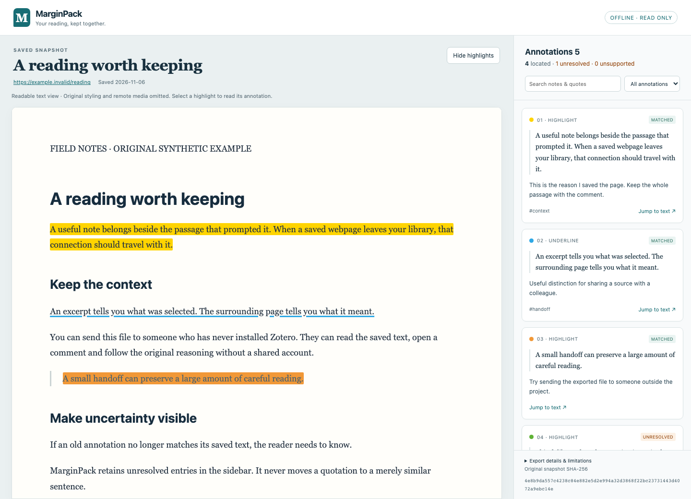

# MarginPack

**Development discontinued on 2026-11-06.** No further features, releases, compatibility testing or promotion are planned. Version 0.1.2 and the source remain available as historical work, without a maintenance commitment. Read the [decision and product review](docs/CLOSEOUT.md) before installing or contributing.

**Export your existing Zotero webpage annotations as one offline HTML file.**

Keep the saved page, highlights and comments together. The recipient opens the file in a browser, clicks a note and reads it in its original context. No Zotero installation, account or hosted viewer is required to read the export.

[Download the latest release](https://github.com/feiiiiii5/marginpack/releases) · [First export & troubleshooting](docs/QUICKSTART.md) · [中文说明](README.zh-CN.md) · [Open a problem report](https://github.com/feiiiiii5/marginpack/issues/new/choose)



## What it does

- Reads a **saved HTML snapshot and its existing Zotero annotations**. There is no need to annotate the page again in another tool.
- Preserves text context, annotation colors, quotes, comments and tags in a standalone reader.
- Shows an outcome for every annotation: matched, unresolved or unsupported. A changed quote is never silently relocated.
- Lets the recipient jump to a highlighted passage and toggle highlights.
- Keeps saved-page table-of-contents and footnote links inside the offline reader, and preserves source language and reading direction.
- Offers a copyable troubleshooting summary containing only version, counts and ordinal annotation statuses, without source content or identifiers.
- Uses a readable static presentation. Original scripts, page CSS and unsupported resources are removed; this is not a pixel-perfect website archive.

MarginPack is an independent third-party project, unaffiliated with Zotero or SingleFile. Version 0.1.2 is an early release with a deliberately narrow format boundary. See [validation and compatibility](docs/VALIDATION.md).

## Install and export

1. Download `marginpack-0.1.2.xpi` from [Releases](https://github.com/feiiiiii5/marginpack/releases).
2. In Zotero 10, open **Tools → Plugins**, then install the downloaded file.
3. Select one downloaded **HTML snapshot attachment**, or a parent item containing exactly one HTML snapshot.
4. Choose **Tools → Export annotated snapshot with MarginPack…**. The same action is available in the item's context menu.
5. Choose a **new** `.html` filename. Open the result in a browser and review the annotation status counts before sharing.

MarginPack never replaces an existing destination file. It does not edit the original snapshot, annotations or library records. If the snapshot has not been downloaded, download it in Zotero first.

See the [first-export and troubleshooting guide](docs/QUICKSTART.md) for choosing the correct snapshot, reviewing unresolved records and sharing the result. Sidebar search and filters change the display; they do not remove private content from the file.

For a no-install preview, download `marginpack-demo.html` from the release and open it locally. Its page and annotations are original synthetic examples, not a real user's research.

## Supported in 0.1

The Zotero adapter targets the **10.0.x** series. The validation record distinguishes application API checks, real native save-dialog checks, and browser tests for each tested platform. Snapshot locations use Zotero's CSS and UTF-16 text-position selectors. Highlights, underlines and note comments are supported; unresolved and unsupported records remain visible in the exported file.

Only existing **single-file UTF-8 HTML snapshots** are in scope. PDF/EPUB annotations, arbitrary local website folders, external images, embedded frames, editing annotations in the export, live webpage updates and import back into Zotero are outside this release. Missing resources are not fetched. Keep the original library as your authoritative editable copy.

The export includes the source content and your selected snapshot's annotations. Review private notes, tags and source URLs before sharing. A successful match is a location check; it does not verify the truth of the source or the right to redistribute it.

## Why this exists

Users have asked how to export annotations already made on Zotero HTML snapshots, including [this thread](https://forums.zotero.org/discussion/113670/save-export-annotated-html-snapshot-with-all-annotated-text-colors-preserved) and [this discussion of the required interactive viewer](https://forums.zotero.org/discussion/115743/save-as-export-function-for-the-website-snapshot). Exporting annotation excerpts as a note is useful, but it does not deliver the whole saved page with comments at their original positions.

MarginPack implements that specific handoff. It does not replace Zotero's reference management or SingleFile's webpage capture.

## Development

The exporter is an original browser JavaScript implementation with **no runtime dependency**. The Zotero adapter uses application APIs, not a database reader. Playwright is a development dependency for exercising generated files in real browsers.

```sh
npm ci
npx playwright install chromium firefox
npm run check
npm test
npm run test:browser
npm run build
```

The deterministic XPI build requires Python 3 and writes artifacts to `dist/`. Run `node scripts/demo.mjs` to regenerate the synthetic demo and screenshot before a release. The build also generates `dist/updates.json`; publish that manifest at the repository root only with its matching release package. See [architecture](docs/ARCHITECTURE.md), [contributing](CONTRIBUTING.md) and [security](SECURITY.md).

## Credit and license

Created by [feiiiiii5](https://github.com/feiiiiii5) with AI coding assistance. MIT licensed. See the validation record for tested behavior and current limits. API and selector references are credited in [architecture](docs/ARCHITECTURE.md). This repository does not bundle Zotero or SingleFile source code, trademarks or real library data.
