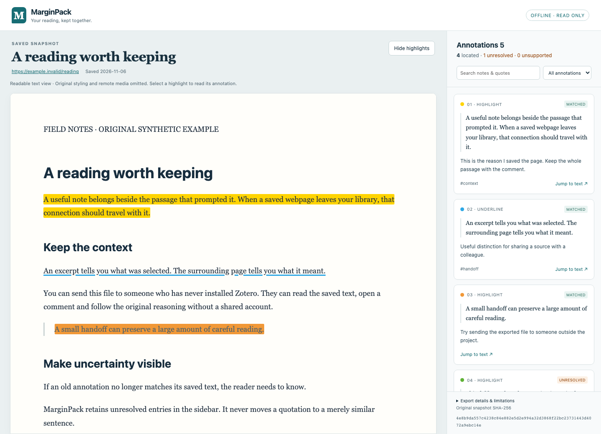

# MarginPack

**项目已于 2026-11-06 停止投入。** 不再安排新功能、版本发布、兼容测试或推广。保留 0.1.2 和源码供查阅，不承诺持续维护。原因与经验见[收尾及产品复盘](docs/CLOSEOUT.md)。

把 **Zotero 中已有的网页快照和批注**，导出为一个可离线阅读的 HTML 文件。

接收方用浏览器打开文件，就能看到原文、高亮和评论，点击批注即可查看对应上下文。阅读导出文件不需要安装 Zotero、注册账号或连接云端查看器。

[下载版本](https://github.com/feiiiiii5/marginpack/releases) · [入门与排障](docs/QUICKSTART.zh-CN.md) · [English](README.md) · [反馈问题](https://github.com/feiiiiii5/marginpack/issues/new/choose)



## 使用

1. 从 Releases 下载 `marginpack-0.1.2.xpi`。
2. 在 Zotero 10 的 **工具 → 插件**中安装文件。
3. 选中一个已经下载的 HTML 网页快照附件；也可以选中仅包含一个 HTML 快照的父条目。
4. 点击工具菜单中的 **Export annotated snapshot with MarginPack…**，或使用条目右键菜单的同名操作。
5. 选择一个新的 `.html` 文件名。用浏览器打开导出物，核对批注状态后再分享。

插件不覆盖已有文件，不修改原快照、批注或资料库条目。未下载的快照需要先在 Zotero 中下载。

[入门与排障指南](docs/QUICKSTART.zh-CN.md)介绍如何选对附件、检查未恢复记录和分享文件。侧栏搜索与筛选只改变显示，不会从文件中删除私人内容。

可先下载版本附件中的 `marginpack-demo.html` 体验。演示页面和批注均为原创合成示例。

## 首版范围

版本 0.1.2 面向 Zotero **10.0.x**，实际应用测试固定使用 **10.0.7**；各系统的原生保存、应用 API 与浏览器测试结果分别记录在测试说明中。支持其 CSS／UTF-16 文本位置选择器表达的高亮、下划线和文字评论。每条输入批注都会保留记录，准确匹配、未恢复、不支持的数量分别展示；不能确认位置时不进行模糊迁移。

首版面向单文件 UTF-8 HTML 快照。页面会重建为适合阅读的静态内容，原网页脚本、CSS 和不支持的资源会被移除。暂不支持 PDF／EPUB、旧式多文件网站目录、联网补全图片、导出物编辑或回写 Zotero。

导出文件包含原文与该快照的批注。分享前检查私人评论、标签和来源网址。请保留资料库中的原件；成功匹配位置不代表内容事实已核验或文件可以公开传播。

这是独立的第三方开源项目，与 Zotero、SingleFile 无隶属关系。它解决已有阅读工作的交付问题，不替代参考文献管理或网页抓取。[测试与兼容性记录](docs/VALIDATION.md)明确区分浏览器测试与实际应用测试。

## 开发

需要 Node.js 22+ 与 Python 3。导出器无运行时依赖。

```sh
npm ci
npx playwright install chromium firefox
npm run check
npm test
npm run test:browser
npm run build
```

发布前运行 `node scripts/demo.mjs` 更新合成演示与截图。构建生成的 `dist/updates.json` 必须与同一安装包一起发布到仓库根目录；Zotero 通过 GitHub 检查插件更新。导出的阅读文件不会自动联网。

欢迎提供不含私人数据的最小复现。详见 [贡献说明](CONTRIBUTING.md)、[安全说明](SECURITY.md)和[架构](docs/ARCHITECTURE.md)。项目由 [feiiiiii5](https://github.com/feiiiiii5) 使用 AI 编程辅助开发，采用 MIT 许可证；测试范围按实际执行情况记录。
